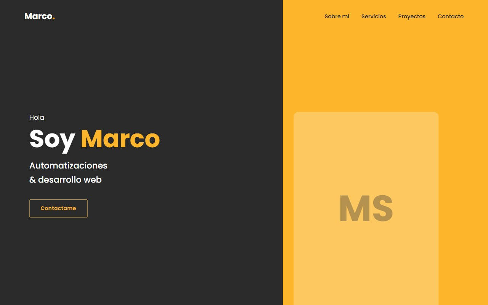
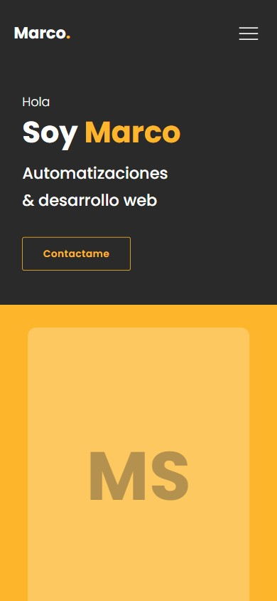

# Portafolio de Marco Saad

Mi portafolio web: automatizaciones y desarrollo web. Sitio estático hecho a mano, sin frameworks, con el código comentado.

**Ver en vivo:** https://marcosaad.github.io/Portafolio/





## Tecnologías
HTML, CSS (variables, diseño responsive) y JavaScript. Publicado gratis con GitHub Pages.

## Cómo verlo localmente
No necesita instalar nada: bajá el repo y abrí `index.html` en el navegador.

```
git clone https://github.com/MarcoSaad/Portafolio.git
```

## Estructura
- `index.html`: contenido de la página.
- `css/style.css`: estilos.
- `js/main.js`: comportamiento (menú, animaciones).
- `img/`: imágenes y capturas de los proyectos.

## Qué aprendí
- HTML da la estructura, CSS el estilo y JavaScript el comportamiento.
- Git: commits, ramas, merge, conflictos, `.gitignore`, push y pull.
- Publicar gratis con GitHub Pages.
